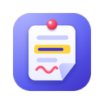
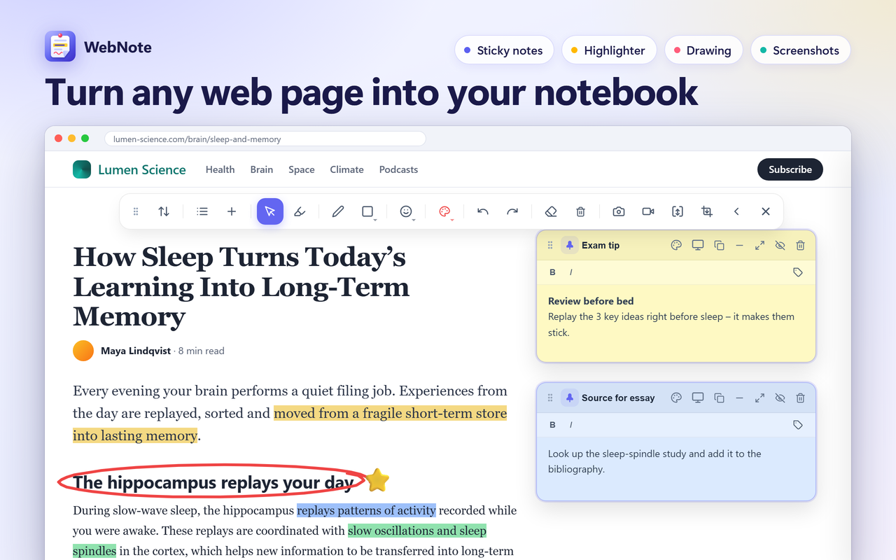
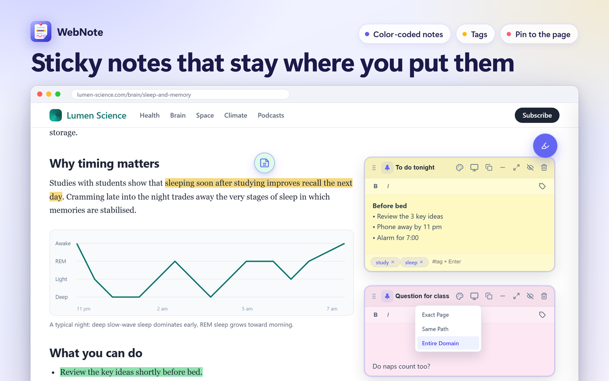
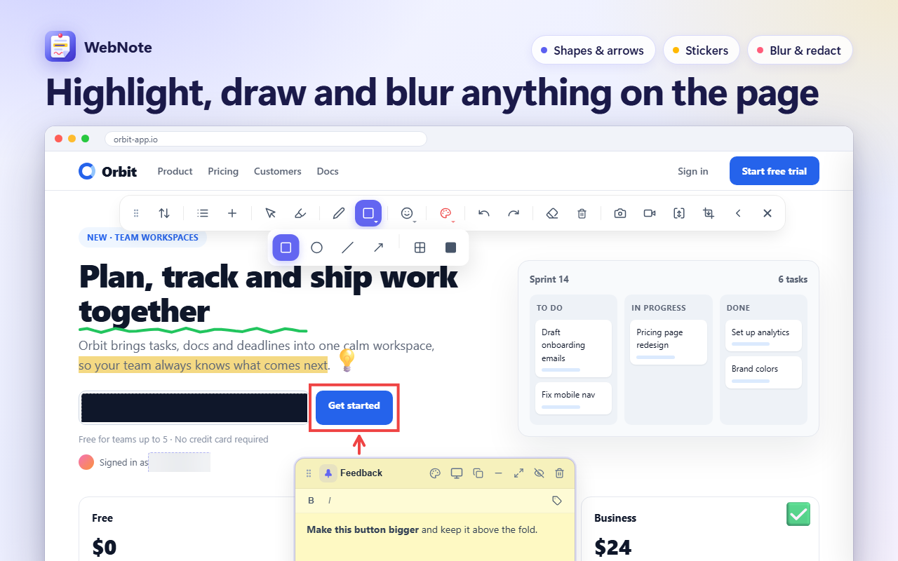
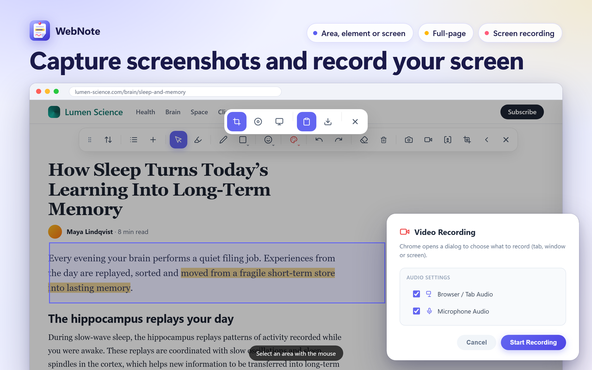
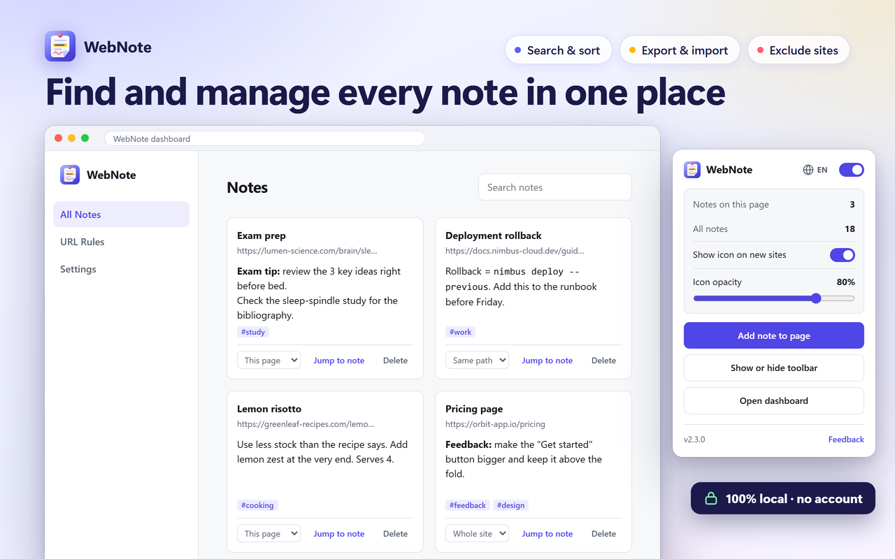

<h1 align="center">WebNote: Draw, Highlight & Sticky Notes</h1>

<b>Sticky notes, a text highlighter, drawing tools and screenshots on any web page. Everything stays on your device: no account, no cloud, no tracking.</b>

  
  
  
  

## Features

- **Sticky notes on any website**: drag, resize, color and tag them, pin them to the page, collapse them to a floating icon. Choose whether a note shows on this page, on the same path or on the whole site.
- **Text highlighter**: highlight text in several colors; highlights are saved and restored automatically.
- **Draw and annotate**: freehand pen, rectangles, circles, lines, arrows and emoji stickers, with undo and redo.
- **Blur and redact**: cover private details with a frosted-glass blur or a solid box before you share a screenshot.
- **Screenshots and screen recording**: capture an area, an element, the visible screen, a full page or a scrolling area; record a tab, a window or the screen with optional audio.
- **Sidebar and dashboard**: search, sort and group your notes, jump back to a note, export and import a JSON backup, exclude websites.
- **Your toolbar, your way**: drag it, switch between horizontal and vertical, minimize or hide it.
- **English and German**: switch the language with the globe icon in the popup.

| | |
|---|---|
|  |  |
|  |  |

## Install

- **Chrome, Brave and other Chromium browsers:** [Chrome Web Store](https://chromewebstore.google.com/detail/iackibmejkkglddhagppoeifbfgchlni)
- **Microsoft Edge:** [Edge Add-ons](https://microsoftedge.microsoft.com/addons/detail/webnote-draw-highlight-/lkmoaolmckolcikghcafiilfgnohibce)
- **From source:** see [Development](#development).

## Getting started

1. Open any web page, click the WebNote icon and choose **Add note to page**. You can also right-click and choose **WebNote: Create Note**.
2. Use the floating toolbar to highlight text, draw, take screenshots or open the notes sidebar.
3. Click the icon and **Open dashboard** to see the notes from all your websites.

WebNote does not run on internal browser pages (`chrome://`, `edge://`) or in the extension stores.

## Permissions and privacy

Notes, highlights, drawings and settings stay in `chrome.storage.local` on your device. WebNote has no server and makes no network requests. Read the [privacy policy](docs/PRIVACY_POLICY.md).

| Permission | Why it is needed |
|---|---|
| Access to all websites | show your notes, highlights and drawings on any page you visit |
| `storage` | save your notes and settings on your device |
| `activeTab`, `scripting` | start WebNote on the current page from the popup |
| `contextMenus` | the right-click actions |
| `downloads` | save the screenshots and recordings you create |
| `clipboardWrite` | copy a screenshot to the clipboard when you choose to |

## Support

- Questions, bugs or ideas: [open an issue](https://github.com/exUs541/Website-Notes/issues).
- More about WebNote and the other extensions: [exus541.github.io/portfolio](https://exus541.github.io/portfolio/index.html), with a [feedback form](https://exus541.github.io/portfolio/feedback.html).

## Development

The extension runs straight from this folder, there is no build step.

1. Clone the repository.
2. Open `chrome://extensions` (or `edge://extensions`) and switch on **Developer mode**.
3. Choose **Load unpacked** and select the repository folder.

| Path | Purpose |
|---|---|
| `manifest.json` | extension manifest (Manifest V3) |
| `background.js` | service worker: context menus, downloads, badge |
| `content.js`, `content.css` | everything on the page: toolbar, notes, highlights, drawing, capture |
| `popup.html`, `popup.js`, `popup.css` | toolbar popup |
| `dashboard.html`, `dashboard.js`, `dashboard.css` | notes dashboard |
| `i18n.js` | English and German strings |
| `icons/` | extension icons |
| `store-assets/` | store texts, screenshots, logo sources and their generator, see its [README](store-assets/README.md) |
| `docs/` | privacy policy |
| `tests/` | `node tests/check.js` runs the source checks |
| `.github/` | release pipeline, see [RELEASING.md](.github/RELEASING.md) |
